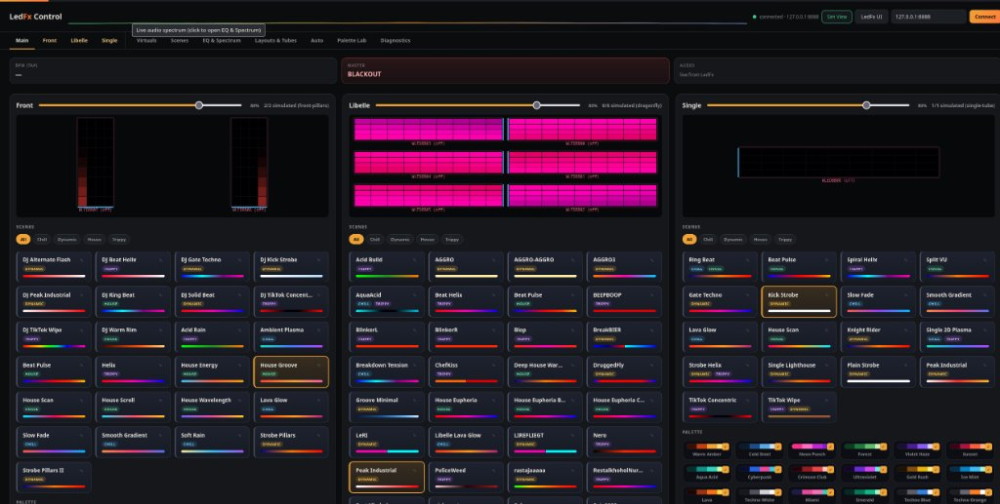

==========================================
LedFx DJ Fork — Live Tube & Audio Control
==========================================

Custom LedFx fork tailored for live DJ sets with 36-segment RGBW WLED tubes
(4 segments per side, 9 rings per tube) on Linux and macOS.

Quick Start
===========

.. code-block:: bash

   # Install dependencies
   uv sync --all-extras --dev

   # Run LedFx from source (opens /control automatically; pass --no-open-ui to skip)
   uv run ledfx

Once running, the live DJ controller is served directly by LedFx (auto-connects
to ``location.host`` with zero CORS/origin setup):

- ``http://127.0.0.1:8888/control`` (or ``/dj``)
- ``http://<your-lan-ip>:8888/control``

Highlights & Features
=====================

1. Live DJ Controller (``ledfx-control.html`` at ``/control`` & ``/dj``)
-----------------------------------------------------------------------

- **Multi-Layout Horizontal Decks:** Active stage layouts appear side-by-side on
  the **Main** tab with live **Sim View / Real View** tube previews, per-layout
  brightness faders, scene tag filters (``chill``, ``house``, ``dynamic``,
  ``trippy``), per-layout palette cycling, speed/sensitivity controls, and hits.
- **Dedicated Layout Tabs & Inline Scene Editor:** Click any layout tab to
  focus on that zone, adjust schema-driven effect parameters (gradients, colors,
  sensitivity, speed, orientation) in real time, **Clone Virtual for Scene**,
  and save updates or new scenes.
- **Scenes Tab (Scene Studio):** Full scene creator/editor to add/remove
  virtuals, pick effects, adjust virtual mapping (``span``/``copy``, ``rows``,
  ``grouping``, ``rotate``), edit tags, preview live, and save.
- **Header & Transport:** Live audio energy bar, full-width header spectrum
  waveform, clickable **BPM (tap)** box, **BLACKOUT** master button, **LedFx UI**
  shortcut, and keyboard shortcuts (``1``–``9``, ``B``, ``T``, ``E``, ``M``).
- **Palettes & Palette Lab:** Custom palette builder with HSL shift, 3-band role
  mapping, BPM/audio-peak color cycling, and palette deletion/restore.

2. Tube-Native Effects (``ledfx/effects/tube_*.py``)
----------------------------------------------------

- ``tube_beat_pulse``, ``tube_ring_beat``, ``tube_solid_beat``, ``tube_split_vu``,
  ``tube_gate``, ``tube_helix``, ``tube_strobe_helix``, and ``tube_lighthouse``
  (with per-scene ``Vertical`` / ``Horizontal`` orientation and virtual
  ``rotate`` support).

3. Zero-Latency 5-Band Incoming Audio EQ & Spectrum Analyzer
------------------------------------------------------------

- **Backend (``ledfx/effects/audio.py``, ``ledfx/configuration/models.py``):**
  5-band frequency-domain EQ (``60 Hz``, ``250 Hz``, ``1 kHz``, ``4 kHz``,
  ``12 kHz``, ``-24.0`` to ``+24.0 dB``) applied directly to the FFT magnitude
  spectrum in ``pre_process_audio()`` before melbank/beat analysis.
- **UI (**EQ & Spectrum** tab):** High-DPI log-frequency spectrum analyzer with
  peak-hold markers, live EQ response curve overlay, DJ EQ presets, and audio
  input device selector (``/api/audio/devices``).

4. Physical Layout Profiles & Graphical Stage Grid (``/api/layouts``)
---------------------------------------------------------------------

- **Layout Profiles (``ledfx/api/layouts.py``):** Named ``layout_profiles``
  stored in ``config/config.json`` (``GET/POST/PUT/DELETE /api/layouts``) with
  layout ordering (``←`` / ``→``) in **Layouts & Tubes**.
- **Graphical Stage Grid & Tube Arranger:** Place tubes in 2D, mark LED-0 start
  edges, independently toggle **Flip X** / **Flip Y** mirroring, and switch
  between **Ring-Grouped** (``grouping=4``) and **Full 36px** (``grouping=1``).

5. Device Auto-Reconnect & Thread-Safety Fixes
----------------------------------------------

- ``auto_reconnect_devices`` toggle in ``LedFxConfig`` paired with manual
  ``POST /api/devices/{id}`` reconnects, timeout-enforced DNS/mDNS resolution,
  and thread-safe ``Device._pixels`` / ``AudioInputSource`` / ``Melbank`` locks.

Project Tracking & Docs
=======================

- `TODO.md <TODO.md>`_ — Planned features and follow-up tasks.
- `BUGS.md <BUGS.md>`_ — Known open issues and resolved bug log.
- `AGENTS.md <AGENTS.md>`_ — Repository conventions and fork architecture.

Testing
=======

.. code-block:: bash

   # Run unit tests for fork additions & device/audio fixes
   .venv/bin/pytest -v --noconftest \
     tests/test_audio_eq.py \
     tests/test_layouts.py \
     tests/test_wled_native_destination.py \
     tests/test_device_lifecycle_regressions.py \
     tests/test_device_config_locking.py \
     tests/test_virtual_clear_effect.py \
     tests/test_melbank_config.py
